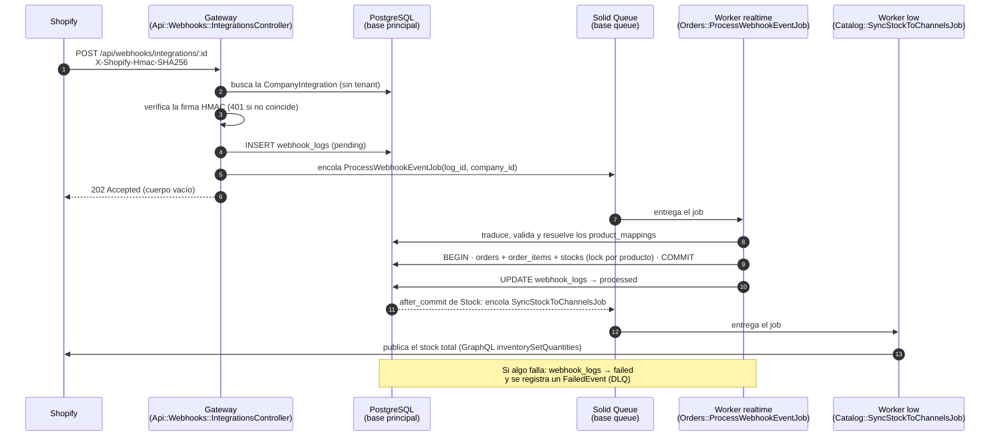

# Flujo de un webhook de venta, de punta a punta

Qué pasa desde que un cliente compra en Shopify hasta que el OMS registra la venta, descuenta el stock y vuelve a publicarlo en los canales. Es el flujo central del sistema y el que cruza más piezas: gateway público, cola, multi-tenancy, traducción por plantilla, Identity Mapping, locks de stock, sync saliente y Dead Letter Queue.

Este documento sigue **un evento** por todas las piezas. Las decisiones detrás de cada una están en los ADRs enlazados. Para correrlo en una máquina local, ver la demo de la [guía de setup](setup-local.md#7-demo-una-venta-por-webhook-de-punta-a-punta).

---

## 1. Vista general



El proveedor recibe su `202` en el paso 6, antes de que se procese nada. Todo lo que sigue corre en workers.

| Pieza | Archivo | Cola / tabla |
| --- | --- | --- |
| Gateway | `app/controllers/api/webhooks/integrations_controller.rb` + concern `EventIngestion` | `webhook_logs` |
| Verificación de firma | `app/poros/webhooks/verify_signature.rb` | — |
| Job de ingesta | `app/jobs/orders/process_webhook_event_job.rb` | `realtime` |
| Caso de uso | `app/poros/orders/process_webhook_order.rb` | `orders`, `order_items` |
| Traducción | `app/poros/orders/translate_webhook_payload.rb` | `services.response_mapper` |
| Identity Mapping | modelo `ProductMapping` | `product_mappings` |
| Descuento de stock | `app/poros/catalog/deduct_stock.rb` + `with_stock_lock.rb` | `stocks` |
| Sync saliente | `app/jobs/catalog/sync_stock_to_channels_job.rb` + `app/poros/catalog/outbound_sync.rb` | `low` |
| Dead Letter Queue | `app/poros/webhooks/register_failed_event.rb` y el motor de ADR-008 | `failed_events`, `low` |

---

## 2. Antes del primer evento: la suscripción

Shopify avisa porque alguien le dijo adónde. Al configurar la conexión en el backoffice, `Integrations::RegisterWebhook` suscribe la tienda al tópico `ORDERS_CREATE`, con la dirección del gateway de **esa integración**:

```
${PUBLIC_WEBHOOK_BASE_URL}/api/webhooks/integrations/<company_integration_id>
```

Cada integración (empresa + proveedor) tiene su propia dirección. Por eso el gateway sabe de qué empresa es el evento sin que haya un usuario logueado. La suscripción es idempotente: primero busca si ya existe ([ADR-019](../adr/ADR-019-ventas-entrantes-de-shopify.md)).

---

## 3. Paso a paso

### 3.1 El gateway recibe y suelta (sincrónico, milisegundos)

`POST /api/webhooks/integrations/:company_integration_id`, sin JWT. El concern `Api::Webhooks::EventIngestion`:

1. **Saltea la autenticación y el tenant del `ApplicationController`.** No hay usuario: el tenant sale de la integración.
2. **Busca la integración con `unscoped`**, por el id de la URL. Si no existe, responde **404**.
3. **Verifica la firma** (`Webhooks::VerifySignature`) si la plantilla la declara en `services.webhook_config`. Shopify firma con HMAC-SHA256 del **body crudo**, usando el `client_secret` de la integración. Si la firma falta o no coincide, responde **401** y no persiste nada. Si la plantilla exige firma y la integración no tiene el secreto, también rechaza: nunca se saltea la verificación.
4. **Persiste el evento crudo** en `webhook_logs` con `status: pending`:
   - `payload`: el JSON del body. Si no es JSON válido, se guarda igual como `{ "raw": "<body>" }`.
   - `headers`: los `HTTP_*` del request, **sin** `Cookie` ni `Authorization`.
   - `company_id`: el de la integración, con `Current.company_id` forzado a `nil` durante el insert para que nada lo pise.
5. **Encola** `Orders::ProcessWebhookEventJob(webhook_log_id, company_id)`, sólo si la plantilla es de tipo `ecommerce`. El job lleva ids, nunca el payload.
6. **Responde `202 Accepted`** con el cuerpo vacío.

> El evento queda escrito **antes** de encolar. Si el proveedor reenvía o la cola se purga, la fila sigue siendo la fuente de verdad del evento ([ADR-020 §1](../adr/ADR-020-decisiones-tardias-broker-dlq-identity-mapping.md)).

### 3.2 El job aporta el tenant (cola `realtime`)

Solid Queue entrega el job a un worker de la cola `realtime` (5 threads, sondeo cada 0,1 s). `ProcessWebhookEventJob`:

- activa el tenant con `with_tenant(company_id)`. Desde acá, toda consulta pasa por el `default_scope` de `CompanyScoped`, y al terminar `ApplicationJob` limpia `Current` para que el próximo job del mismo thread no herede la empresa;
- busca el `WebhookLog`. Si se borró mientras esperaba, termina sin error;
- delega en `Orders::ProcessWebhookOrder` y, si éste levanta una excepción, la deriva a la DLQ (§4). **No la propaga.**

### 3.3 Traducir el payload con la plantilla

El OMS no tiene código por proveedor. `Orders::TranslateWebhookPayload` aplica el `response_mapper` del `Service` de la integración, que mapea rutas del JSON externo a claves internas:

```jsonc
// Plantilla "Shopify" (db/seeds.rb), extracto
{
  "id":                          "external_order_id",
  "financial_status":            "status",
  "shipping_address.name":       "customer_name",
  "shipping_address.province":   "customer_province",
  "line_items[].variant_id":     "external_product_id",   // por cada elemento de line_items…
  "line_items[].quantity":       "quantity",
  "line_items[].price":          "unit_price"
}
```

El marcador `[]` describe la lista de ítems ([ADR-010](../adr/ADR-010-ingesta-de-ordenes-de-webhooks.md)). El `response_value_mapper` traduce valores (`authorized` → `pending`, `voided` → `cancelled`). El resultado es un hash con la orden (`ORDER_KEYS`) y sus ítems (`ITEM_KEYS`).

### 3.4 Validar: estricto con la venta, permisivo con lo accesorio

Antes de escribir nada, `ProcessWebhookOrder` corta con `InvalidPayloadError` si:

- falta `external_order_id` (sin él no hay idempotencia);
- la lista de ítems viene vacía;
- la plantilla no pudo leer algún elemento de la lista (la orden entraría con menos renglones de los vendidos);
- un ítem no tiene cantidad positiva, o no tiene precio ni en el payload ni en el vínculo.

No corta por un `status` desconocido (entra como `pending`), por una provincia que no reconoce (entra sin provincia) ni por datos del comprador faltantes. La venta es el dato que no se puede perder. La tabla completa está en ADR-010.

### 3.5 Idempotencia: ¿ya entró esta venta?

Tres barreras, porque la entrega es *at-least-once* (Shopify reintenta y un job puede correr dos veces):

1. Un log ya `processed` no se reprocesa.
2. Si ya existe una `Order` con ese `external_order_id` **en la misma integración**, se marca el log `processed` y no se crea nada.
3. Si dos workers llegan a la vez, el índice único `index_orders_on_integration_and_external_order_id` deja pasar a uno solo. El otro captura el `RecordNotUnique` de **ese índice** y termina como duplicado.

### 3.6 Identity Mapping: del id del canal al producto interno

Cada `external_product_id` (en Shopify, el id de la variante) se busca en `product_mappings`, **filtrando por la integración que recibió el evento**: el mismo id puede existir en otro canal y apuntar a otro producto ([ADR-020 §3](../adr/ADR-020-decisiones-tardias-broker-dlq-identity-mapping.md)).

- Se resuelven **todos** antes de abrir la transacción. Un id sin vínculo levanta `UnmappedProductError` y la venta no se escribe.
- Los ítems se ordenan por `product_id`. Así dos ventas con productos en común toman los locks en el mismo orden y no se bloquean entre sí ([ADR-009](../adr/ADR-009-bloqueos-distribuidos.md)).

### 3.7 La transacción: orden, ítems y stock juntos

```
BEGIN
  INSERT orders (status, cliente, dirección, company_integration_id, external_order_id)
  por cada ítem, en orden de product_id:
    Catalog::DeductStock
      pg_advisory_xact_lock(<clave de empresa + producto>)   ← se sostiene hasta el COMMIT
      elige el primer depósito (por warehouse_id) que cubra la cantidad completa
      UPDATE stocks SET quantity = quantity - n
    INSERT order_items (producto, depósito elegido, cantidad, precio)
  UPDATE orders SET total_amount = Σ cantidad × precio
COMMIT
```

Cualquier fallo (stock insuficiente en todos los depósitos, una validación) hace rollback de todo: no queda orden sin descuento ni descuento sin orden. Una venta que llega **ya cancelada** se registra igual, pero sin descontar stock.

Fuera de la transacción, el log pasa a `processed`. Si falló, pasa a `failed` con `error_message` (`"Orders::ProcessWebhookOrder::UnmappedProductError: external product '…' is not mapped…"`). El registro del resultado va afuera a propósito: un rollback se llevaría puesto el registro del error.

### 3.8 El efecto de rebote: el stock vuelve a los canales (cola `low`)

Cada `UPDATE stocks` dispara, **después del commit**, el callback `after_commit` del modelo `Stock`, que encola `Catalog::SyncStockToChannelsJob(product_id, company_id)` en la cola `low`. El job:

- recalcula el stock total del producto **al ejecutarse**, no al encolarse, así que publica el valor vigente;
- recorre los `product_mappings` del producto en integraciones **activas** cuya plantilla sabe publicar stock (`Service#stock_template`);
- llama a cada canal con el `HttpAdapter` genérico. En Shopify: la mutación GraphQL `inventorySetQuantities`, con el `inventory_item_id` de `external_refs` y una clave de idempotencia por intento.

Shopify también descontó su stock al vender. El valor final en la tienda es el del OMS, que es la fuente de verdad. Si un canal falla, los demás reciben el stock igual y el job se reintenta con el `retry_on` de Active Job (5 intentos con espera creciente). **Este camino no pasa por la DLQ** ([ADR-020 §2](../adr/ADR-020-decisiones-tardias-broker-dlq-identity-mapping.md)).

---

## 4. Cuando algo falla: la Dead Letter Queue

Si `ProcessWebhookOrder` levanta cualquier excepción, el job la captura y llama a `Webhooks::RegisterFailedEvent`:

```
failed_events
  event_type:  webhooks.order_ingestion
  direction:   inbound
  payload:     { "webhook_log_id": 42 }      ← referencia, no copia del evento
  status:      pending
  attempts:    0 / max_attempts: 5
  next_retry_at: ahora + 1 minuto (+ jitter)
  last_error:  "Orders::ProcessWebhookOrder::UnmappedProductError: …"
```

A partir de ahí trabaja el motor de reintentos ([ADR-008](../adr/ADR-008-dead-letter-queue.md)):

```
cada minuto  Webhooks::ScanDueFailedEventsJob (low, sin tenant, unscoped)
               └─ por cada evento vencido: Webhooks::RetryFailedEventJob(id, company_id)
                    ├─ claim atómico: UPDATE … SET status = processing WHERE <reclamable>
                    │    (0 filas → otro worker lo tomó, termina)
                    └─ Webhooks::RetryFailedEvent
                         └─ ReplayRegistry['webhooks.order_ingestion']
                              = Webhooks::Replayers::OrderIngestion
                                   └─ ProcessWebhookOrder sobre el MISMO WebhookLog
```

Ciclo de vida del evento:

```
pending ──(cron)──> processing ──(éxito)──────────────> succeeded
   ^                     │
   └──(falla, quedan)────┤   backoff: 1m, 2m, 4m, 8m, 16m (+ hasta 30 s)
                         └──(5 intentos)──> dead ──(retry manual)──> pending
                                                 └──(discard)──> discarded
```

Un evento muerto llega a `dead` unos 30 minutos después del fallo original. Desde la API de la empresa:

| Endpoint | Para qué |
| --- | --- |
| `GET /api/v1/failed-events?status=dead` | Ver qué falló y por qué (`last_error`) |
| `POST /api/v1/failed-events/:id/retry` | Reintentar ya, con el contador en cero, sin esperar al cron |
| `POST /api/v1/failed-events/:id/discard` | Sacarlo del ciclo de reintentos |

El caso típico es una venta con un producto que nadie vinculó. El evento termina `dead`, el operador crea el vínculo (`POST /api/v1/products/:id/mappings`), dispara el retry y la venta entra con su stock descontado. Nadie toca la base a mano. El reintento es idempotente: si la orden ya se había creado por otro camino, el replay corta sin duplicar.

---

## 5. Estados que deja el recorrido

| Tabla | Camino feliz | Con fallo |
| --- | --- | --- |
| `webhook_logs` | `pending` → `processed` | `pending` → `failed` (+ `error_message`) → `processed` si un reintento sale bien |
| `orders` / `order_items` | una orden con sus líneas, cada una con el depósito del que salió | nada |
| `stocks` | descontado del depósito elegido | sin cambios |
| `failed_events` | nada | una fila `inbound` que termina en `succeeded`, `dead` o `discarded` |
| Solid Queue | un job en `realtime` y uno por producto en `low` | además, un job de reintento por intento en `low` |

Lo que ve el usuario de la empresa en el front: la orden en el listado de órdenes y en la actividad reciente (`GET /api/v1/activity`). Si falló, ve un aviso de evento fallido en la misma actividad.

---

## 6. Garantías y límites

- ✅ **Ninguna venta entra a medias.** Orden, líneas y stock van en una sola transacción.
- ✅ **Ninguna venta entra dos veces**, aunque el proveedor reenvíe o dos workers corran a la vez.
- ✅ **Ninguna venta se pierde por un fallo de procesamiento.** Queda en `webhook_logs` y en la DLQ, y se puede reprocesar.
- ✅ **Ningún evento sin firma válida se persiste**, para las plantillas que declaran firma (Shopify).
- ✅ **El proveedor nunca espera** detrás de la lógica de negocio: recibe su `202` en milisegundos.
- ⚠️ Si el log se guarda pero el encolado falla, el evento queda `pending` sin procesar. No hay barrido de logs pendientes.
- ⚠️ Las plantillas que no firman (Mercado Libre, los couriers de los seeds) aceptan cualquier evento en su gateway.
- ⚠️ Una venta falla si ningún depósito **por sí solo** cubre la cantidad de un ítem, aunque el total alcance.
- ⚠️ Un push de stock que agota sus reintentos no aparece en `/api/v1/failed-events`.

---

## 7. El webhook de un courier, por comparación

`POST /api/webhooks/couriers/:company_integration_id` usa el mismo concern: firma, `WebhookLog`, `202`. Cambia lo que encola: `Shipments::ProcessTrackingEventJob`, que traduce el payload con la plantilla del courier, ubica el envío por `tracking_number` y registra el movimiento (`ShipmentEvent` + `shipments.status`) bajo `shipment.lock!`. Si falla, va a la DLQ como `webhooks.tracking_ingestion`. Detalle en [ADR-011](../adr/ADR-011-push-tracking-de-couriers.md). Los couriers sin webhooks se consultan cada 30 minutos ([ADR-014](../adr/ADR-014-pull-tracking-de-couriers.md)).
